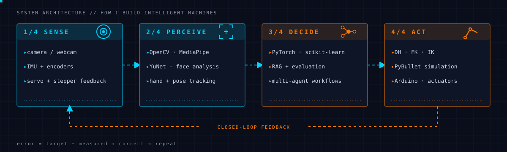

<div align="center">



<a href="https://www.linkedin.com/in/muneer-ahmed-khokhar-b06368398"></a>
<a href="https://www.youtube.com/@ailearning-v4u"></a>
<a href="mailto:muneerahmedkhokhar53@gmail.com"></a>


<br/><br/>



</div>

<br/>

## System architecture

I think of every project as a closed loop: sense the world, perceive it, decide, act, then measure the error and correct.

<div align="center">

</div>

## Selected projects

Each project is tagged with the stages of the loop it covers.

| ID | Project | What it does | Stack | Loop |
|:--:|---|---|---|:--:|
| `R-01` | [Hand Teleoperation: KUKA iiwa](https://github.com/muneerahmedkhokhar53-wq/hand-teleoperation-kuka-iiwa) | Webcam hand tracking drives a simulated robot arm and gripper for pick-and-place. | Python · MediaPipe · OpenCV · PyBullet | 1 → 4 |
| `R-02` | [Arm Kinematics: DH, FK & IK](https://github.com/muneerahmedkhokhar53-wq/Arm-Kinematics-DH-Forward-Inverse-) | Forward and inverse kinematics using Denavit–Hartenberg methods. | Python · Robotics | 4 |
| `V-01` | [Cybernetic AR HUD](https://github.com/muneerahmedkhokhar53-wq/Cybernetic_AR_Hud_Project) | Interactive vision HUD with hand gestures and optional perception modules. | Python · OpenCV · MediaPipe | 1 → 2 |
| `V-02` | [Face Recognition Attendance](https://github.com/muneerahmedkhokhar53-wq/face-recognition-attendance-System) | Computer-vision attendance prototype. | Python · OpenCV · YuNet · LBPH · MediaPipe | 1 → 3 |
| `A-01` | [RAG System + Evaluation Harness](https://github.com/muneerahmedkhokhar53-wq/RAG-system-with-an-evaluation-harness) | Document-grounded question answering with citations and a repeatable evaluation workflow. | Python · Retrieval · Evaluation | 3 |
| `A-02` | [Multi-Agent AI Research Assistant](https://github.com/muneerahmedkhokhar53-wq/Multi-Agent-AI-Research-Assistant) | Searches, reads, drafts, and critiques source-backed reports. | Python · LangChain · Streamlit | 3 |

> Features and maturity vary between projects. Each repository documents its setup, limitations, and current status.

## Kinematics core

The idea behind my arm work: every joint is one homogeneous transform, and the end effector is their product.

```python
import numpy as np

def dh(theta, d, a, alpha):
    """Standard Denavit–Hartenberg transform: Rz(θ)·Tz(d)·Tx(a)·Rx(α)."""
    ct, st, ca, sa = np.cos(theta), np.sin(theta), np.cos(alpha), np.sin(alpha)
    return np.array([[ct, -st*ca,  st*sa, a*ct],
                     [st,  ct*ca, -ct*sa, a*st],
                     [0,      sa,     ca,    d],
                     [0,       0,      0,    1]])

def forward(joints):            # joints = [(θ, d, a, α), ...]
    T = np.eye(4)
    for j in joints:
        T = T @ dh(*j)
    return T                    # base → end effector
```

## Toolkit

<div align="center">


</div>

## Engineering protocol

```text
1. build the smallest testable version first
2. document install, config, controls, and known limits
3. prefer measured results over unsupported performance claims
4. treat privacy and safe operation as design requirements,
   especially for camera-based systems
```

## Currently exploring

Robotics and AI integration · reliable computer-vision pipelines · robot kinematics and control · evaluation methods for AI applications

<div align="center">

<br/>



</div>
